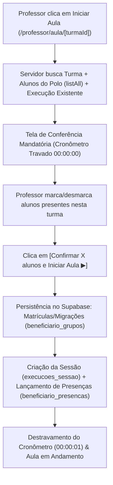

# Plano de Implementação: Conferência de Alunos e Enturmação na Área do Professor

## 1. Visão Geral e Diagnóstico

### Situação Atual no Banco de Dados
* **Total de Beneficiários Ativos no Sistema:** 1.126
* **Alunos com Enturmação (`beneficiario_grupos`):** 604 (53,6%)
* **Alunos no Polo Aguardando Enturmação ("Sem turma"):** 522 (46,4%)
* **Turmas Cadastradas:** 61 turmas (32 turmas completamente sem alunos vinculados).
* **Bloqueio no Código:** Atualmente, a rota [`web/src/app/(dashboard)/professor/aula/[turmaId]/page.tsx`](file:///c:/projetos/andorinha/cadastro%20de%20beneficiarios/web/src/app/(dashboard)/professor/aula/%5BturmaId%5D/page.tsx) busca apenas `beneficiariosApi.list({ turmaId, limit: 200 })`. Como 32 turmas possuem 0 alunos, o professor é bloqueado na largada com o erro: *"Não é possível iniciar a aula: nenhum beneficiário matriculado nesta turma"*.

### Objetivo da Solução
Transformar o momento em que o professor clica em **"Iniciar Aula"** no motor de saneamento e distribuição contínua dos alunos:
1. **Carregamento Unificado do Polo:** O professor tem acesso a todos os alunos do seu polo (com e sem turma).
2. **Gate de Conferência com Tempo Travado:** O cronômetro oficial do treino permanece travado em `00:00:00` até o professor confirmar quais alunos estão presentes e pertencem àquela turma.
3. **Distribuição Natural em 1 Ciclo:** Conforme o professor inicia suas aulas ao longo da semana (ex: Turma A de manhã, Turma B à tarde), os alunos confirmados são oficializados no banco (`beneficiario_grupos`), saem da lista de "Sem turma" e o saldo residual ao fim da semana aponta com precisão quem nunca compareceu.
4. **Aplicação Universal:** O fluxo é o mesmo **inclusive se a turma já tiver alunos enturmados**, permitindo retificar enturmações incorretas de forma contínua no dia a dia.

---

## 2. Tratamento das 4 Condições dos Beneficiários

| Condição | Estado no Banco | Comportamento na Conferência | Ação ao Confirmar |
| :--- | :--- | :--- | :--- |
| **1. Sem turma** | Sem registro em `beneficiario_grupos` | Exibe badge `Sem turma` e botão `[+ É da Turma]` | Cria vínculo em `beneficiario_grupos` e lança presença |
| **2. Na turma correta** | `beneficiario_grupos` com `grupo_id === turma.id` | Já vem pré-selecionado como `[✓ Confirmado]` | Mantém vínculo e lança presença na sessão |
| **3. Na turma errada** | `beneficiario_grupos` vinculado a outra turma | Exibe badge `Matriculado na Turma X` e botão `[Mover p/ esta Turma]` | Executa migração para a nova turma e lança presença |
| **4. Ausente / Desconhecido** | Não compareceu ao treino | Permanece desmarcado pelo professor | Continua sem turma, acumulando saldo para a próxima turma |

---

## 3. Arquitetura Técnica e Fluxo de Dados

### Arquivos Envolvidos
1. [`web/src/app/(dashboard)/professor/aula/[turmaId]/page.tsx`](file:///c:/projetos/andorinha/cadastro%20de%20beneficiarios/web/src/app/(dashboard)/professor/aula/%5BturmaId%5D/page.tsx):
   - Buscar todos os beneficiários ativos do polo (`beneficiariosApi.listAll({ nucleoId: turma.nucleoId, status: 'ativo' })`).
   - Passar a lista completa do polo (`beneficiariosPolo`) e a lista já matriculada para o cliente.
2. [`web/src/components/professor/ExecucaoSessaoClient.tsx`](file:///c:/projetos/andorinha/cadastro%20de%20beneficiarios/web/src/components/professor/ExecucaoSessaoClient.tsx):
   - Adicionar estado de conferência pré-aula quando a sessão ainda não estiver em andamento.
   - Remover o bloqueio estático de `beneficiarios.length === 0`.
   - Renderizar o painel de conferência com os contadores (`Total no Polo`, `Nesta Turma`, `Sem Turma`), busca e ação de confirmação.
   - No `handleIniciarAula`, efetivar a enturmação/migração dos alunos selecionados no Supabase e registrar suas presenças antes de disparar o timer.
3. [`web/src/lib/api/services.ts`](file:///c:/projetos/andorinha/cadastro%20de%20beneficiarios/web/src/lib/api/services.ts):
   - Adicionar método auxiliar em lote `turmasApi.sincronizarConferenciaEnturmacao(turmaId, alunosConfirmadosIds)` para garantir consistência atômica e performance na gravação.
