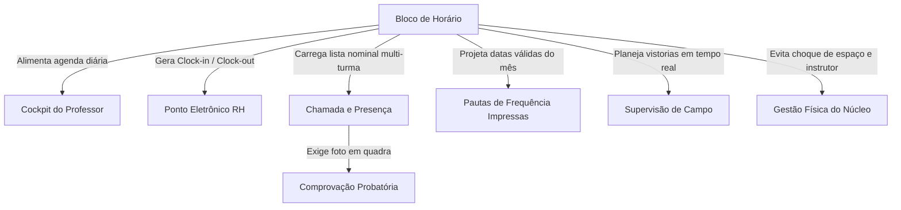
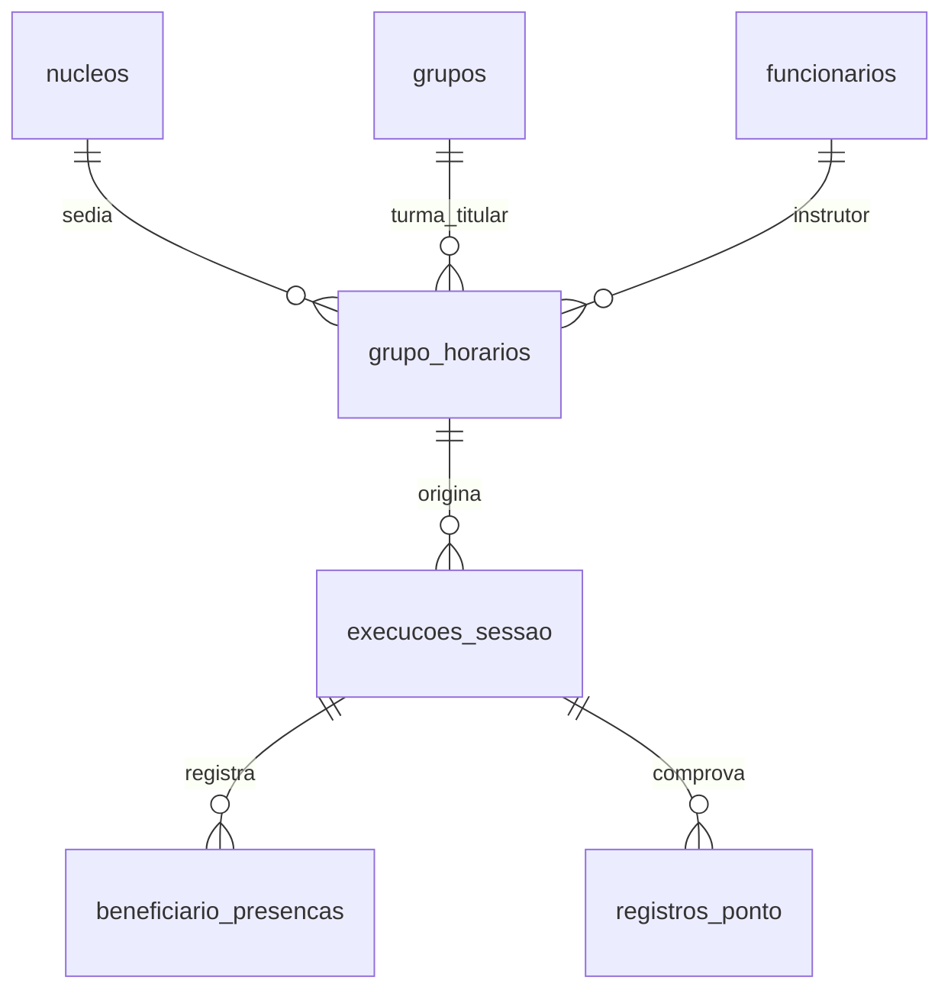
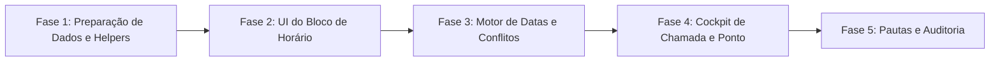

# Plano Mestre: Evolução de Slots para Blocos de Horário e Agendamento

## 1. Visão Geral e Propósito

Este plano estabelece a evolução arquitetural e operacional do sistema, substituindo o antigo conceito técnico de **"Slot"** pelo conceito de **"Bloco de Horário"** no banco oficial (**`qrzszjogxrrjqjkoowoi`**).

O **Bloco de Horário** passa a ser a unidade fundamental de tempo e espaço do projeto, amarrando:
1. **Janela Temporal:** Horário de início e término com validação de consistência.
2. **Local / Núcleo:** Espaço físico onde a aula ou evento ocorre (`nucleos`).
3. **Instrutor Responsável:** O profissional de campo escalado (`funcionarios`).
4. **Enturmação Flexível:** Vincula a turma titular, mas suporta nativamente **múltiplas turmas conjuntas** (aulões integrados, clínicas, festivais).
5. **As Regras de Recorrência Temporal:**
   - **Dia único:** Evento pontual com data específica (ex.: uma corrida de rua, festival ou torneio);
   - **Semanal:** Recorrência fixa nos dias selecionados da semana (padrão de escolinhas esportivas, ex.: Ter e Qui);
   - **Mensal:** Recorrência periódica mensal com duas modalidades:
     - *Por dia fixo do mês* (ex.: todo dia 10, com tratamento configurável de fim de semana/feriado);
     - *Por dia da semana* (ex.: todo 1º sábado do mês ou última sexta-feira).

> [!IMPORTANT] Delimitação de Escopo: Agendamento vs. Aula / Sessão
> A entidade **Aula / Sessão** é a figura mais importante do sistema, pois representa o **snapshot concreto da execução da atividade fim** (chamada nominal realizada, fotos probatórias em quadra, registros de ponto e auditoria).
> **Diretriz Estratégica:** O trabalho atual foca **exclusivamente em resolver de ponta a ponta a questão do Agendamento (Bloco de Horário, enturmação e recorrências)**. O snapshot da Aula/Sessão e a sua mecânica de execução em campo serão abordados na etapa posterior, com o agendamento já devidamente assentado e estável.

---

## 2. Mapa dos 6 Efeitos Refletidos no Sistema

### 2.1 Efeito 1: Chamada e Presença Nominal Multi-Turma
- **Situação:** Ao iniciar o bloco, o professor vê os alunos matriculados nas turmas participantes.
- **Se for bloco individual:** Lista simples dos alunos da turma.
- **Se for bloco conjunto (Turma A + Turma B):** Lista consolidada organizada por turma, permitindo chamada unificada sem corromper a matrícula original de cada aluno.

### 2.2 Efeito 2: Ponto Eletrônico e Jornada do Instrutor (`registros_ponto`)
- **Ato de Iniciar o Bloco:** Dispara a marcação de ponto de entrada (`clock-in`).
- **Ato de Finalizar o Bloco com Foto:** Dispara a marcação de ponto de saída (`clock-out`).
- **Proteção contra fragmentação:** Blocos contínuos no mesmo núcleo dentro da mesma janela formam uma jornada unificada no espelho de ponto do RH.

### 2.3 Efeito 3: Motor de Datas e Regras de Recorrência
- Motor de cálculo que recebe a regra do bloco e projeta o calendário de datas válidas de qualquer mês:
  - *Semanal:* Identifica todas as ocorrências dos dias marcados no mês.
  - *Mensal Fixo:* Identifica o dia $X$ e ajusta para dia útil anterior/posterior se cair em sábado, domingo ou feriado.
  - *Mensal por Dia da Semana:* Localiza a $N$-ésima ocorrência do dia da semana (ex.: 1º sábado ou última sexta-feira).
  - *Pontual:* Data específica isolada.

### 2.4 Efeito 4: Pautas de Frequência Impressas A4 (`/relatorios/frequencia`)
- As colunas de datas da pauta de frequência impressa são geradas dinamicamente com base nas datas reais calculadas pelo motor para aquele mês, eliminando colunas estáticas cegas.

### 2.5 Efeito 5: Supervisão de Campo (Vistorias In Loco)
- O supervisor em campo consulta o núcleo e vê os blocos ativos no momento da visita, validando:
  - Presença do instrutor escalado;
  - Presença das turmas previstas;
  - Contagem física de alunos em quadra batendo com a lista do app.

### 2.6 Efeito 6: Prevenção de Conflitos Físicos e de Escala
- **Alerta de Núcleo:** Evita que dois blocos ocupem a mesma quadra/campo no mesmo horário (a menos que seja compartilhado explicitamente).
- **Alerta de Professor:** Evita que o mesmo instrutor seja escalado em dois núcleos diferentes no mesmo horário.

---

## 3. Arquitetura de Dados no Banco Oficial (`qrzszjogxrrjqjkoowoi`)

Para garantir **zero quebras** e transição 100% segura, evoluímos a tabela de horários adicionando campos opcionais com defaults coerentes:

### Campos do Bloco em `grupo_horarios`:
* `id`: uuid (PK)
* `nucleo_id`: uuid (FK nucleos)
* `responsavel_id`: uuid (FK funcionarios)
* `atividade_id`: uuid (FK atividades)
* `grupo_id`: uuid (FK grupos - turma titular)
* `hora_inicio`: time (obrigatório)
* `hora_fim`: time (obrigatório)
* `tipo_recorrencia`: text (default: `'semanal'`, opções: `'semanal'`, `'mensal_dia_fixo'`, `'mensal_dia_semana'`, `'pontual'`)
* `dia_semana`: smallint (0 a 6 para semanal e mensal por dia da semana)
* `dia_mes`: smallint (1 a 31 para mensal fixo)
* `ordem_semana_mes`: smallint (1, 2, 3, 4, -1 para última semana)
* `ajuste_fim_de_semana`: text (`'manter'`, `'proximo_util'`, `'anterior_util'`)
* `data_especifica`: date (para evento pontual)
* `grupos_adicionais_ids`: uuid[] (turmas parceiras integradas no mesmo bloco)

---

## 4. Fases de Execução Atômica

1. **Fase 1 (Banco & Helpers):** Adição segura dos campos de recorrência e enturmação conjunta em `grupo_horarios`, mantendo total retrocompatibilidade com as turmas e horários existentes.
2. **Fase 2 (UI de Configuração):** Evolução da tela de horários em `GrupoForm.tsx` e `GradeSemanal.tsx` substituindo o vocabulário de "Slot" por "Bloco de Horário", com abas visuais para as 4 recorrências e seletor de turmas parceiras.
3. **Fase 3 (Motor de Datas & Conflitos):** Implementação de `lib/agendamento.ts` com funções puras de projeção de calendário e validação de choques de agenda.
4. **Fase 4 (Cockpit e Chamada Nominal):** Adaptação do fluxo de início de aula, chamada nominal multi-turma e registro de ponto com comprovação fotográfica.
5. **Fase 5 (Pautas e Supervisão):** Atualização do gerador de pauta A4 e do fluxo de vistoria presencial da coordenação.
