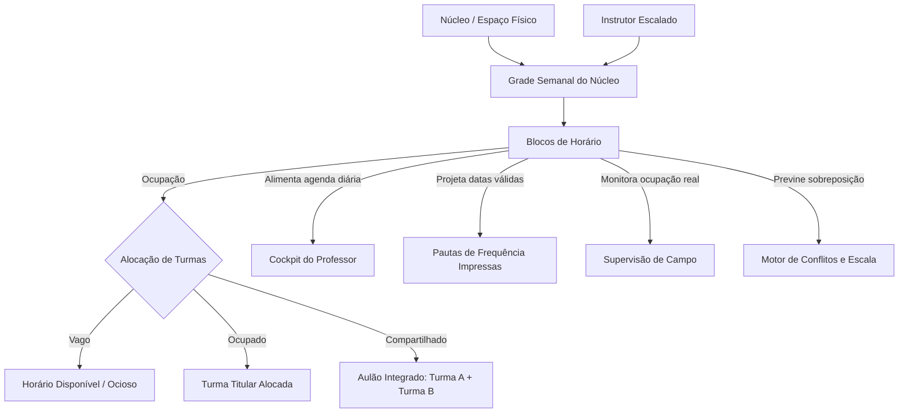
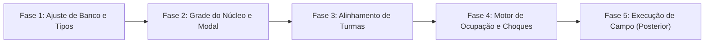

# Plano Mestre: Grade de Horários e Agendamento Centrado no Núcleo

## 1. Visão Geral e Princípio da Inversão de Centralidade

Este plano estabelece a evolução arquitetural e operacional do sistema de agendamento no banco oficial (**`qrzszjogxrrjqjkoowoi`**).

O princípio fundamental é a **Inversão da Centralidade**:
- **O tempo e o espaço físico pertencem ao Núcleo (`nucleos`) e à escala dos profissionais de campo (`funcionarios`)**, e não à Turma isolada.
- No modelo anterior, a Turma criava horários soltos no vácuo, gerando fragmentação, choques de quadra e impossibilidade de enxergar a ociosidade do núcleo.
- No novo modelo, **a Grade Semanal e de Agendamento pertence ao Núcleo**. O gestor monta a grade de atendimento do espaço (com os profissionais escalados) e, em seguida, as turmas são alocadas nesses blocos (ou criadas diretamente a partir deles).

---

## 2. A Entidade "Bloco de Horário" do Núcleo

O **Bloco de Horário** é a unidade fundamental de tempo e espaço do Núcleo, amarrando:
1. **Espaço Físico / Núcleo:** O local onde a atividade ocorre (`nucleo_id` obrigatório).
2. **Janela Temporal:** Horário de início e término com validação de duração.
3. **Instrutor Responsável:** O profissional de campo escalado (`responsavel_id`).
4. **Modalidade:** Atividade esportiva/cultural planejada (`atividade_id`).
5. **Regras de Recorrência com Repetição:**
   - **Semanal:** Repetição nos dias selecionados da semana (ex.: Terça e Quinta, Seg/Qua/Sex ou Seg a Sex);
   - **Mensal:** 
     - *Por dia da semana* (ex.: 1º e 3º sábado do mês para clínicas quinzenais);
     - *Por dia fixo do mês* (ex.: dias 10 e 25 com tratamento de fim de semana/feriado);
   - **Pontual:** Eventos e clínicas em datas específicas.
6. **Ocupação Flexível (Alocação de Turmas):**
   - **Bloco Vago / Planejado:** Horário reservado no núcleo aguardando turma (`grupo_id` nulo);
   - **Bloco Ocupado:** Alocação de uma turma titular (`grupo_id`);
   - **Bloco Compartilhado (Enturmação Conjunta):** Duas ou mais turmas alocadas juntas para aulões integrados (`grupos_adicionais_ids`).

> [!IMPORTANT] Delimitação de Escopo: Agendamento vs. Aula / Sessão
> O trabalho atual foca **exclusivamente na Grade do Núcleo, Blocos de Horário, repetições, alocação de turmas e prevenção de choques**.
> O snapshot da Aula/Sessão (chamada em campo, fotos probatórias e ponto eletrônico) será abordado na etapa posterior com a grade já estabilizada.

---

## 3. Mapa dos Efeitos no Sistema



---

## 4. Fluxo Operacional na Interface

```mermaid
flowchart TD
    T1[1. Tela do Núcleo] --> T2[2. Grade Semanal do Núcleo]
    T2 -->|Filtro Opcional| FP[Filtrar por Instrutor / Modalidade]
    T2 -->|Clique ou Arrasto| MB[3. Modal de Bloco de Horário]
    MB -->|Repetição| RP[Semanal com múltiplos dias / Mensal / Pontual]
    MB -->|Definição de Ocupação| OC{Status do Bloco}
    OC -->|Opção 1| VAG[Manter Bloco Vago para Planejamento]
    OC -->|Opção 2| ALOC[Vincular Turma(s) Existente(s)]
    OC -->|Opção 3| CRIA[Criar Nova Turma diretamente no Bloco]
    T3[4. Tela de Turma GrupoForm] -->|Seleção Visual| SL[Selecionar Blocos Disponíveis do Núcleo]
```

1. **Gestor acessa o Núcleo:** Abre a aba/tela de Grade do Núcleo e enxerga a capacidade instalada, horários vagos e ocupados.
2. **Criação com Repetição Inteligente:** O modal permite configurar o bloco e pergunta se deve repetir em outros dias da semana (ex.: cria Ter e Qui com 1 clique).
3. **Alocação Imediata ou Posterior:** O gestor pode associar uma turma existente, criar uma turma nova ali mesmo ou deixar o bloco como vaga planejada.
4. **Formulário de Turmas (`GrupoForm`):** A turma vincula os blocos de horário que seu núcleo disponibilizou, garantindo coerência física total.

---

## 5. Arquitetura de Dados no Banco Oficial (`qrzszjogxrrjqjkoowoi`)

Evolução de `grupo_horarios`:
* `id`: uuid (PK)
* `nucleo_id`: uuid (FK nucleos, **obrigatório** como âncora do bloco)
* `responsavel_id`: uuid (FK funcionarios - instrutor escalado)
* `atividade_id`: uuid (FK atividades)
* `hora_inicio`: time (obrigatório)
* `hora_fim`: time (obrigatório)
* `tipo_recorrencia`: text (`'semanal'`, `'mensal_dia_fixo'`, `'mensal_dia_semana'`, `'pontual'`)
* `dia_semana`: smallint (0 a 6 para semanal e mensal por dia da semana)
* `dia_mes`: smallint (1 a 31 para mensal fixo)
* `ordem_semana_mes`: smallint (1, 2, 3, 4, -1 para última semana)
* `ajuste_fim_de_semana`: text (`'manter'`, `'proximo_util'`, `'anterior_util'`)
* `data_especifica`: date (para agendamento pontual)
* `grupo_id`: uuid (FK grupos - **opcional**, representa a turma titular alocada no bloco)
* `grupos_adicionais_ids`: uuid[] (turmas parceiras integradas no mesmo bloco)

---

## 6. Fases de Execução Atômica



1. **Fase 1 (Banco & Tipos):** Tornar `grupo_id` opcional no banco para suportar blocos vagos/planejados e atualizar tipagens de API.
2. **Fase 2 (Grade do Núcleo e Modal):** Interface visual da Grade no Núcleo com filtros por professor, modal de criação com repetição inteligente e alocação de turmas.
3. **Fase 3 (Formulário de Turmas):** Adequação de `GrupoForm.tsx` para selecionar blocos do núcleo.
4. **Fase 4 (Motor de Ocupação e Choques):** Detecção de choques de espaço físico no núcleo e choques de jornada do instrutor.
5. **Fases 5 e 6 (Etapa Posterior):** Snapshot da execução da aula, chamada nominal multi-turma, ponto com foto e auditoria de campo.
